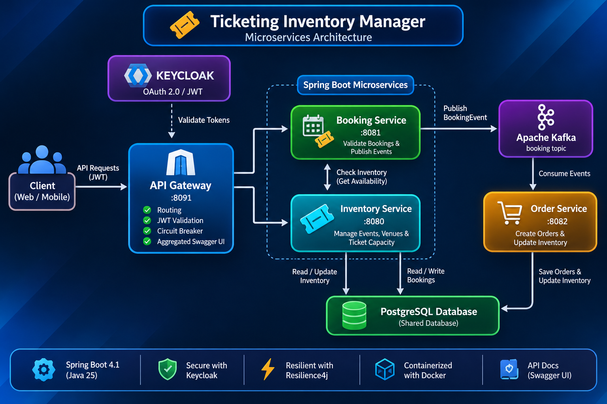

# 🎟️ Ticketing Inventory Manager

An event-driven ticketing backend built as four Spring Boot microservices. Customers browse events, book tickets through a secured API gateway, and the system processes each booking asynchronously over Kafka, creating an order and decrementing ticket inventory.

**Stack:** Java 25 · Spring Boot 4.1 · Spring Cloud Gateway · Apache Kafka · PostgreSQL · Flyway · Keycloak (OAuth 2.0 / JWT) · Resilience4j · OpenAPI · Docker Compose

---

## Why this project

It's a compact, realistic example of patterns commonly used in production backends:

- **API gateway pattern**: one public entry point that handles routing, JWT validation and fault tolerance.
- **Event-driven communication**: booking and order processing are decoupled with Kafka.
- **Externalised identity**: authentication is delegated to Keycloak, and the gateway acts as an OAuth 2.0 resource server.
- **Resilience**: a circuit breaker with a fallback response protects the booking route.
- **Schema versioning**: database changes are managed with Flyway migrations.
- **Reproducible infrastructure**: Postgres, Kafka and Keycloak all start with one `docker compose` command.

## Architecture

The system follows an event-driven microservices architecture,
using synchronous HTTP communication and asynchronous Kafka messaging.



### Booking flow

1. The client sends `POST /api/v1/book` with a Keycloak-issued JWT to the **gateway**.
2. The gateway validates the token and forwards the request to the **booking service** through a circuit breaker. If the service is down, the client gets a `503` fallback response.
3. The booking service verifies that the customer exists, then calls the **inventory service** to check remaining capacity and ticket price.
4. If enough tickets remain, it calculates the total price and publishes a `BookingEvent` to the Kafka `booking` topic. It then returns `201 Created`.
5. The **order service** consumes the event, saves an `Order` and calls the inventory service to reduce the event's remaining capacity.

### Services

| Service | Port | Responsibility |
|---|---|---|
| [`gateway`](gateway) | 8091 | Routing, JWT validation (OAuth 2.0 resource server), circuit breaker and fallback, aggregated Swagger UI, Actuator health |
| [`Inventoryservice`](Inventoryservice) | 8080 (default) | Events, venues and remaining ticket capacity; owns the Flyway migrations |
| [`bookingservice`](bookingservice) | 8081 | Validates bookings and publishes booking events to Kafka |
| [`orderservice`](orderservice) | 8082 | Consumes booking events, persists orders, updates inventory |

## API

All calls go through the gateway at `http://localhost:8091` and require a bearer token, except the Swagger and API-docs paths.

| Method | Path | Description |
|---|---|---|
| `GET` | `/api/v1/inventory/events` | List all events with remaining capacity and ticket price |
| `GET` | `/api/v1/inventory/event/{eventId}` | Inventory for a single event |
| `GET` | `/api/v1/inventory/venue/{venueId}` | Venue details |
| `PUT` | `/api/v1/inventory/event/{eventId}/capacity/{tickets}` | Reduce an event's remaining capacity (called by the order service) |
| `POST` | `/api/v1/book` | Create a booking |

Example booking request:

```json
{
  "userId": 1,
  "eventId": 1,
  "ticketCount": 2
}
```

Interactive docs are available at **http://localhost:8091/swagger-ui.html**. The gateway aggregates the OpenAPI specs of the inventory and booking services into one UI.

## Getting started

### Prerequisites

- Java 25
- Docker and Docker Compose
- Git

### 1. Clone

```bash
git clone https://github.com/iamnana-tyc/ticketing-inventory-manager.git
cd ticketing-inventory-manager
```

### 2. Configure environment variables

Create `Inventoryservice/.env` (git-ignored):

```env
POSTGRES_USER=your_database_username
POSTGRES_PASSWORD=your_database_password

KEYCLOAK_DB_PASSWORD=your_keycloak_database_password
KEYCLOAK_ADMIN=your_keycloak_admin_username
KEYCLOAK_ADMIN_PASSWORD=your_keycloak_admin_password
```

The services read `POSTGRES_USER` and `POSTGRES_PASSWORD` from their environment, so export both in the shell you start each service from.

### 3. Start the infrastructure

```bash
docker compose -f Inventoryservice/docker-compose.yaml up -d
```

This starts PostgreSQL (host port `5433`), Kafka and Zookeeper, Kafka UI (`8084`), Schema Registry (`8083`) and Keycloak with its own database (`8092`).

> Keycloak is started with `--import-realm` from `Inventoryservice/docker/keycloak/realms`, and no realm file is committed. Create a realm named `ticketing-realm-security` in the Keycloak admin console (`http://localhost:8092`), or add your exported realm JSON to that folder.

### 4. Run the services

Start the inventory service first, because it applies the Flyway migrations. Then start the rest, each in its own terminal:

```bash
cd Inventoryservice && ./mvnw spring-boot:run
cd bookingservice   && ./mvnw spring-boot:run
cd orderservice     && ./mvnw spring-boot:run
cd gateway          && ./mvnw spring-boot:run
```

### 5. Load sample data (optional)

After the migrations have run, apply [`database/sample.sql`](database/sample.sql) to the `ticketing` database to insert sample customers, venues and events.

### 6. Call the API

Get a token from Keycloak, then pass it to the gateway:

```bash
curl -H "Authorization: Bearer $TOKEN" http://localhost:8091/api/v1/inventory/events
```

## Design decisions

- **Gateway-level security.** Downstream services never handle tokens. The gateway validates JWTs against Keycloak's JWKS endpoint, which keeps auth logic in one place.
- **Asynchronous order processing.** The booking service returns as soon as the event is published, so it doesn't wait on order persistence or inventory updates. Kafka also lets order handling be scaled or replayed independently.
- **Fault tolerance at the edge.** The booking route uses a Resilience4j circuit breaker with a 3s time limit, a 50% failure threshold, and a graceful `503` fallback.
- **Database migrations as code.** Flyway migrations (`V1`–`V4`) create the events, venues, customers and orders tables. Hibernate's `ddl-auto` is set to `none` so the schema is only changed by migrations.
- **Consistent error handling.** Inventory and booking services each have a `@RestControllerAdvice` that returns a uniform JSON error body (`timestamp`, `status`, `error`, `message`, `path`, plus `fieldErrors` for validation). Typed exceptions map to `404` (not found), `409` (insufficient tickets), `400` (invalid input) and `503` (inventory service down). Unexpected errors return a generic `500` and are logged without leaking internals.
- **Resilient Kafka consumer.** The order service retries failed events with exponential backoff, sends permanently failing ones to the `booking.DLT` dead-letter topic, and rolls back the order insert if the inventory update fails.
- **Layered structure.** Each service separates controller, service, repository and model/DTO layers.

## Known limitations and roadmap

I'd rather be upfront about what's still a work in progress:

- [ ] **Shared database.** All services currently use one PostgreSQL database, so they aren't fully independent. A database per service is the next step.
- [ ] **Inventory race conditions.** The capacity check (booking service) and the decrement (order service) are separate steps with no locking. Concurrent bookings can oversell. Options are optimistic locking on `Event`, or a reservation step with a saga or compensation.
- [ ] **Kafka idempotency.** Failed events are retried and then dead-lettered, but there is no idempotency key, so a redelivered message could still create a duplicate order.
- [ ] **Tests.** Only context-load tests exist today. Unit tests for the service layer and Testcontainers integration tests (Postgres, Kafka) are planned.
- [ ] **Configuration.** Service URLs are hard-coded to `localhost`, so service discovery or per-environment config is needed. The Kafka event class is also duplicated between booking and order services, and could move to a shared module.
- [ ] **Containerise the services** and add a CI pipeline (build and test on every push).

## Project structure

```text
ticketing-inventory-manager/
├── gateway/            # Spring Cloud Gateway: routes, security, circuit breaker
├── Inventoryservice/   # Events, venues, capacity + Flyway migrations + docker-compose
├── bookingservice/     # Booking API + Kafka producer
├── orderservice/       # Kafka consumer + order persistence
└── database/           # Sample data for local development
```

## Author

**Nana Owusu Appiah**: [github.com/iamnana-tyc](https://github.com/iamnana-tyc)
